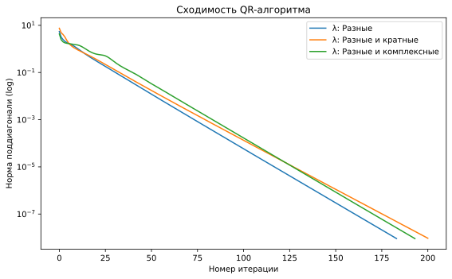

# Численные методы нахождения собственных значений

Курсовая работа по численным методам. Реализация степенного метода, обратных степенных итераций и двух вариантов QR-алгоритма на Python.

**NumPy, Matplotlib.**

## Методы

| Файл | Метод |
|---|---|
| `power.py` | Степенной метод: собственное значение с наибольшим модулем и соответствующий вектор |
| `inverse_power.py` | Обратные итерации: собственное значение с наименьшим модулем |
| `qr.py` | QR-итерации для нахождения спектра матрицы |
| `qr_shifted.py` | Приведение к форме Хессенберга отражениями Хаусхолдера и QR-итерации со сдвигом |

Матрицы примеров строятся из заданного спектра преобразованием подобия. Рассматриваются различные, кратные и комплексные собственные значения. Для генерации матриц используется `seed=11`.

## Запуск

Python 3.11:

```bash
python -m pip install -r requirements.txt
python power.py
python inverse_power.py
python qr.py
python qr_shifted.py
```

Каждый файл запускается отдельно, выводит результат в консоль и открывает график сходимости. Матрицы и параметры можно изменить в блоке запуска в конце файла.

## Сходимость



Для степенных методов остановка определяется невязкой `||Ax − λx||`. Для QR — нормой элементов ниже главной диагонали. В примерах сравнивается влияние расположения собственных значений на скорость сходимости.

## Ограничения

Степенному методу нужен подходящий начальный вектор и выделенное по модулю собственное значение. Обратные итерации требуют невырожденной матрицы. Простая версия QR не рассчитана на все возможные матрицы, в частности вещественные матрицы с комплексными сопряжёнными парами могут не стать треугольными в вещественной арифметике.

Предел вычисления — 10000 итераций. В модифицированном QR используется полный `numpy.linalg.qr`, без специализированного быстрого QR-разложения формы Хессенберга.
